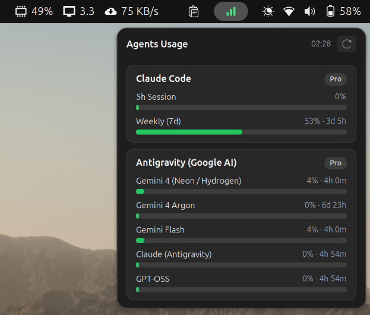

# Agents Providers Usage Bar

Extensão para a barra superior do **GNOME Shell 46** (Ubuntu) acompanhada de uma **CLI em Python** (`agents-usage`) para monitorar em tempo real as cotas de uso das assinaturas do **Claude Code** e do **Antigravity (Google AI)**.

<p align="center">
  
</p>

## O que é o projeto

O projeto resolve o problema de acompanhar limites de uso e janelas de reset de assistentes de IA diretamente do desktop Linux, sem precisar abrir terminais ou painéis web. Ele é composto por duas camadas desacopladas:

1. **Backend / CLI (`agents-usage`)**: coleta as cotas dos provedores em paralelo, normaliza os dados em um formato único, aplica cache local e expõe o resultado em texto ou JSON.
2. **Extensão GNOME Shell (`agents-providers-bar@ailton.local`)**: consome o JSON da CLI de forma assíncrona, exibe um ícone discreto na barra superior com indicação de severidade por cor e renderiza um menu popup com cards detalhados por provedor.

## Funcionalidades

- **Indicador de status na barra superior**: ícone simbólico que muda de cor conforme o maior percentual de uso entre os provedores ativos:
  - **Verde**: `< 60%`
  - **Âmbar**: `60% – 84.9%`
  - **Vermelho**: `>= 85%`
  - **Cinza (muted)**: sem dados disponíveis ou erro
- **Menu popup detalhado**:
  - Cards individuais por provedor com nome, plano (`plan_name`) e status.
  - Barras de progresso por janela de cota (ex.: `5h Session`, `Weekly (7d)`, buckets de modelos do Antigravity).
  - Contagem regressiva formatada para o próximo reset (ex.: `2h 15m`, `3d 4h`).
- **Atualização automática e manual**:
  - Atualiza automaticamente a cada **5 minutos** (`300s`).
  - Botão de **Refresh** no cabeçalho do popup para forçar consulta sem cache (`--no-cache`).
- **Cache local e tolerância a falhas**:
  - Cache armazenado em `~/.cache/agents-providers-bar/usage.json` (TTL padrão de `300s`), gravado de forma atômica.
  - Em caso de *rate limit* (`429`) ou erro momentâneo, faz fallback para o último snapshot em cache (*stale*) preservando os dados de janelas anteriores.

## Como foi feito (Arquitetura)

### Backend Python (`backend/agents_usage/`)

- **Zero dependências externas**: utiliza apenas a biblioteca padrão do Python (`>= 3.10`), como `urllib.request`, `json`, `argparse`, `dataclasses`, `concurrent.futures` e `pathlib`. O projeto é empacotado com `pyproject.toml` e gerenciado via `uv`.
- **`cli.py`**: ponto de entrada `agents-usage`. Executa a coleta dos provedores em paralelo usando `ThreadPoolExecutor`, coordena leitura/escrita no cache e imprime a saída formatada ou em JSON (`--json`).
- **`models.py`**: define os modelos `QuotaWindow`, `ProviderUsage` e `UsageReport`, além da formatação de tempo restante até o reset (`format_reset_in`).
- **`cache.py`**: implementa `UsageCache` com escrita atômica via arquivo `.tmp` + `os.replace`.
- **`providers/claude.py`**:
  - Lê o token OAuth e o tipo de assinatura em `~/.claude/.credentials.json`.
  - Consulta `https://api.anthropic.com/api/oauth/usage` e converte os buckets (`five_hour`, `seven_day`, `seven_day_sonnet`, `seven_day_opus`) em `QuotaWindow`.
- **`providers/antigravity.py`**:
  - Descobre instâncias locais do daemon do Antigravity em `~/.gemini/antigravity/daemon/hub_*.json`, priorizando processos cujo `pid` está ativo.
  - Faz chamada RPC local (`POST http://127.0.0.1:<httpPort>/exa.language_server_pb.LanguageServerService/GetUserStatus`) usando o header `X-Codeium-Csrf-Token`.
  - Agrupa os modelos retornados em buckets (como `Gemini 4 (Neon / Hydrogen)`, `Gemini 4 Argon`, `Gemini Flash`, `Claude (Antigravity)`, `GPT-OSS`) considerando o maior uso por bucket.

### Extensão GNOME Shell (`extension/agents-providers-bar@ailton.local/`)

- Escrita em **GJS (ESM)** para GNOME Shell 46 (`metadata.json` com `"shell-version": ["46"]`).
- **`extension.js`**: registra `AgentsUsageIndicator` (`PanelMenu.Button`), executa `~/.local/bin/agents-usage --json` (com fallback para `agents-usage` no `PATH`) via `Gio.Subprocess` assíncrono e constrói dinamicamente os cards com widgets `St`.
- **`stylesheet.css`** e **`icons/provider-bar-symbolic.svg`**: estilização do popup, barras de progresso e ícone simbólico da barra superior.

## Estrutura do Repositório

```text
.
├── Makefile
├── pyproject.toml
├── uv.lock
├── assets/
│   └── image.png               # Captura de tela da extensão em funcionamento
├── backend/
│   ├── agents_usage/
│   │   ├── cli.py              # Entrypoint CLI e orquestração paralela
│   │   ├── cache.py            # Cache JSON local com escrita atômica
│   │   ├── models.py           # Modelos QuotaWindow, ProviderUsage, UsageReport
│   │   └── providers/
│   │       ├── claude.py       # Coletor OAuth do Claude Code
│   │       └── antigravity.py  # Coletor RPC local do Antigravity
│   └── tests/
│       ├── test_antigravity.py
│       ├── test_cache.py
│       └── test_claude.py
├── extension/
│   └── agents-providers-bar@ailton.local/
│       ├── extension.js        # Indicador e popup do GNOME Shell 46
│       ├── metadata.json       # Metadados da extensão
│       ├── stylesheet.css      # Estilos do popup e ícone
│       └── icons/
│           └── provider-bar-symbolic.svg
└── scripts/
    ├── install.sh              # Instala CLI + symlink da extensão
    └── uninstall.sh            # Remove CLI e desabilita/remove extensão
```

## Pré-requisitos

- Ubuntu com **GNOME Shell 46**
- **Python >= 3.10**
- **`uv`** (recomendado para rodar testes e comandos via `Makefile`)
- **Node.js** (usado apenas no `make lint` para validação sintática de `extension.js`)
- Para dados reais dos provedores:
  - **Claude Code**: autenticado localmente (`~/.claude/.credentials.json` gerado pelo comando `claude`).
  - **Antigravity**: daemon local em execução (iniciado pelo `agy` ou Antigravity IDE).

## Como Instalar

Execute o script de instalação (ou via `Makefile`):

```bash
./scripts/install.sh
# ou
make install
```

O script realiza as seguintes ações:
1. Cria o executável wrapper em `~/.local/bin/agents-usage` apontando para `backend/` com `PYTHONPATH`.
2. Cria um link simbólico da extensão em `~/.local/share/gnome-shell/extensions/agents-providers-bar@ailton.local`.
3. Tenta habilitar a extensão via `gnome-extensions enable agents-providers-bar@ailton.local`.

> **Nota sobre Wayland:** se o GNOME Shell não reconhecer a extensão imediatamente após a instalação, encerre a sessão (logout) e entre novamente, depois execute:
> ```bash
> gnome-extensions enable agents-providers-bar@ailton.local
> ```

### Como Desinstalar

```bash
./scripts/uninstall.sh
# ou
make uninstall
```

## Comandos

### CLI (`agents-usage`)

```bash
# Saída formatada para terminal (usa cache de 300s por padrão)
agents-usage

# Saída em JSON ignorando o cache
agents-usage --json --no-cache

# Filtrar por um provedor específico
agents-usage --provider claude
agents-usage --provider antigravity

# Definir TTL customizado do cache (em segundos)
agents-usage --ttl 60
```

### Atalhos do `Makefile`

| Comando | Descrição |
| :--- | :--- |
| `make run` | Executa `uv run agents-usage --no-cache` |
| `make json` | Executa `uv run agents-usage --json --no-cache` |
| `make test` | Executa a suíte de testes unitários com `uv` |
| `make lint` | Valida sintaxe JS (`node --check`) e JSON (`metadata.json`) |
| `make check` | Executa `lint` e `test` |
| `make install` | Executa `./scripts/install.sh` |
| `make uninstall` | Executa `./scripts/uninstall.sh` |

## Como Testar

### 1. Verificação completa (Lint + Testes Unitários)

```bash
make check
```

Ou executando individualmente:

```bash
# Apenas testes unitários (via uv)
make test

# Apenas testes unitários (sem uv, usando python3 do sistema)
PYTHONPATH=backend python3 -m unittest discover -s backend/tests -v

# Apenas lint da extensão (JS + metadata.json)
make lint
```

### 2. Testar o backend localmente

```bash
make json
```

Verifique se o JSON retornado contém `overall_max_used_percent` e a lista `providers` com os status esperados (`ok`, `unauthenticated`, `unavailable`, etc.).

### 3. Depurar a extensão no GNOME Shell

Para acompanhar logs ou erros da extensão em tempo real no Ubuntu:

```bash
journalctl -f /usr/bin/gnome-shell
```
